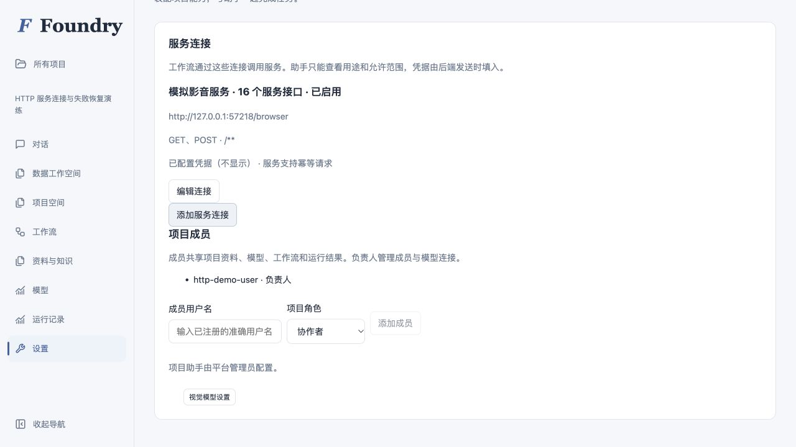
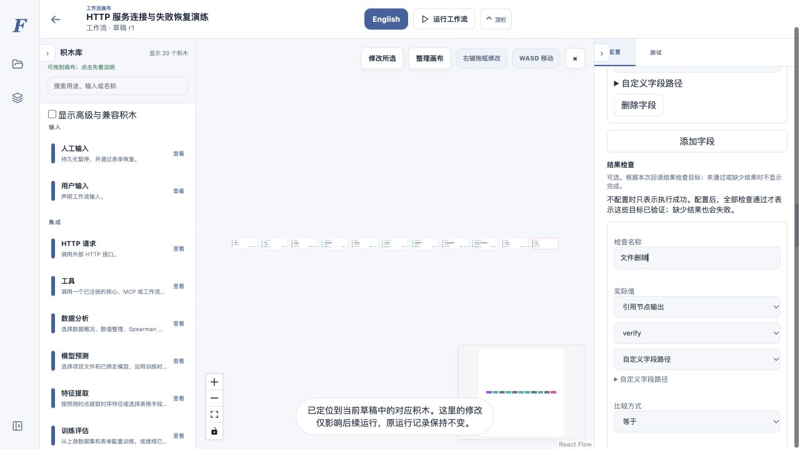
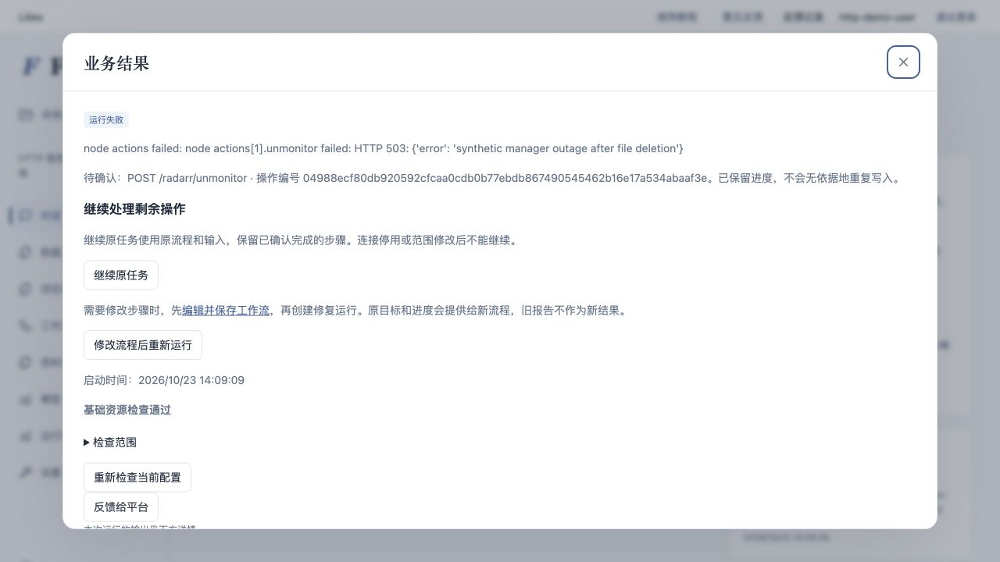
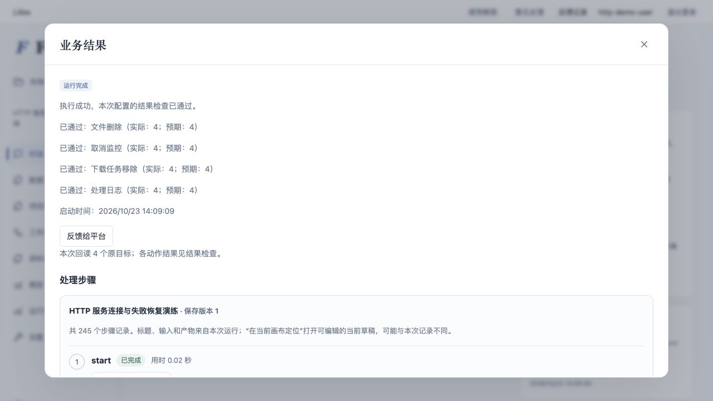
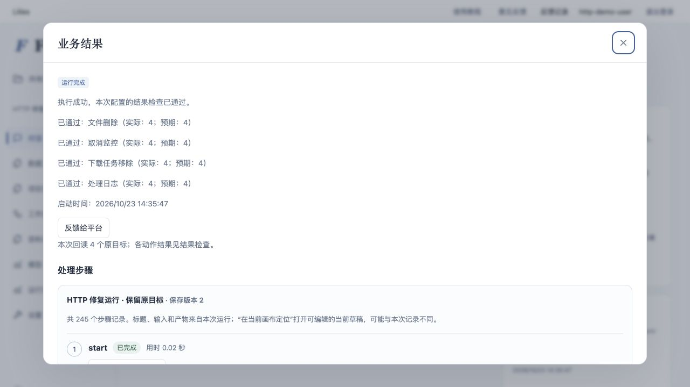

# 项目 HTTP 连接、继续运行与结果检查

本批在 `codex/http-workflow-recovery-20261023` 开发，依赖项目助手能力范围修复 `bc4d47f1`。未合并、未发布，未修改 18401/18402 的服务检出。验证使用普通项目账号、共享助手工具接口和本机合成服务，不调用额外付费模型。

对照用户原架构图的逐项能力边界，见 [影音系统工作流能力报告](MEDIA_WORKFLOW_CAPABILITIES.md)。该报告区分清理编排的已验结果、需要真实接口适配的控制动作，以及外部服务负责的下载、存储和播放。

## 使用方式

1. 负责人或管理员在项目「设置 → 服务连接」配置名称、基础地址、允许路径和 HTTP 方法。认证值只写入后端已有的加密凭据存储；再次编辑时不返回旧值，留空保留旧凭据。协作者和助手只能查看连接说明。
2. 在 HTTP 积木选择连接，填写 `/items` 这样的相对路径。查询参数、正文和输出沿用原有配置。允许路径支持精确路径和 `/items/**`；`/**` 表示此基础地址下的所有路径。不要把令牌写进节点、代码或 URL。
3. 服务明确支持幂等请求标识时，在连接中填写其幂等请求头。仅填写一个头名不能让不支持幂等的服务变得安全。读取最多尝试三次；写入只有已声明幂等，或结果查询明确确认尚未执行时，才自动重试。
4. 失败后选「继续原任务」，沿用原输入、流程快照和操作标识，跳过已确认完成的步骤。需要改流程时，先保存修改，再选「修改流程后重新运行」。新任务保留原目标和进度的只读上下文，旧任务、旧结果保留。
5. 在结束节点用「结果检查」表单添加检查名称、实际值、比较方式、预期值及失败说明。实际值引用本次回读或计算结果；缺值或不通过时运行失败，已完成的步骤和产物仍可查看。没有检查的旧流程只说明执行成功，不能据此称业务目标已验证。





### 连接与恢复的边界

每次运行固定连接目标和允许范围，项目运行、成员工作流、测试和恢复共用检查。重定向逐跳验证，不能借跳转访问其他地址、路径或方法。停用或删除连接会拒绝后续请求；修改目标或权限范围后需启动新运行；仅更新凭据可以继续原任务。系统级网络出口限制仍然生效，项目连接不会绕开管理员的全局网络限制。

Python 代码节点继续禁网。旧独立 HTTP URL 流程保留；项目内旧 URL 节点必须选择项目连接，不自动放开网络。运行状态、工作流和模型上下文不包含后端注入的凭据，服务回显相同凭据时也会隐藏。

状态不明的写入先查询实际状态。未配置查询且没有幂等保证时，停止自动重发并显示操作编号、方法和路径。服务查询失败、缺字段或返回未知值，都不能当成“尚未执行”。这时需要修复查询/流程或确认服务状态，不能无依据地反复点击重试。

### 助手接口

两种项目助手共享 `project_connections(action="list")`、`project_calls` 与 HTTP 积木说明。连接配置不属于助手可写工具。生成方法同时写入共用说明、HTTP 手册和项目 `http_workflows` Skill：完整分页、稳定标识匹配、固定原目标、逐项操作、回读核对；缺失字段、匹配不唯一、时区及部分完成要显式处理。

- `project_calls(action="resume", task_id=...)` 继续原快照。
- `project_calls(action="start", workflow_id=..., recovery_task_id=..., request_key=...)` 创建修复任务，仅允许引用同项目、同工作流的失败或中断任务。
- `$recovery.inputs`、`$recovery.runs[].steps`、`nested_progress`、`http_operations` 提供原输入和进度；连续修复的来源在 `$recovery.original`。这些不是本次报告。
- HTTP `outcome_query` 使用同一连接的 GET，字段包括 `path`、`query`、`result_path`、`completed_value`、`not_applied_value`；查询可引用 `$operation.id` 和 `$operation.request`。写入与结果查询共用连接范围限制。

草稿保存不依赖运行条件。没有新增审批或独立审计系统，也没有增加第二个复核智能体。规则和测试约束已知错误，不保证未来生成不会有新错误。

## 本轮验证

原始对照实验保留在本机 `Documents/ChatGPT/lilies/media-http-trial-20261023/runs/20261023T034929Z/`。当时独立管理员入口成功，普通项目入口被阻止；删除后取消监控失败，新运行因文件已不存在漏掉遗留动作。这些历史失败没有改写为成功。

本批把同一假后端纳入 `tests/fixtures/media_http_backend.py`，使用真实 HTTP、真实工作流和 Docker 离线适配代码。它提供 16 类合成接口、13 条影片，**不是 Emby、Radarr 等原厂协议兼容实现**，没有真实 NAS 文件操作。

| 场景 | 核对方法与结果 |
|---|---|
| 普通账号与共享助手调用 | 负责人配置连接；协作者读取说明并通过项目调用；密钥不出现在任务、事件或接口返回中 |
| 权限范围 | 跨项目、越界路径/方法、地址跳转、停用、范围修改、撤销项目成员均拒绝；凭据轮换可继续 |
| 数据与业务判断 | 完整读取 13 条；同名不用标题匹配，重复外部编号保留不确定；Keep、任一用户未看完、做种、网盘指针、缺时间和 24 小时边界分别判断 |
| 服务故障 | 503 读取有限重试；401 不重试；字段变化和文件版本变化失败；写入已发生但响应失败时保留操作编号，幂等重试或回读确认 |
| 部分完成 → 继续 | 保持原任务与运行编号，补齐取消监控、下载移除和日志；每个目标只删除一次 |
| 部分完成 → 修改后修复 | 新任务读取原目标并补齐余项；原任务仍失败，原报告不成为新输出；删除仍只发生一次 |
| 未确认写入 | 无幂等和查询时不自动重发；多层成员调用的容错设置不能把未确认写入吞成成功 |
| 漏掉必要动作 | 故意省略日志，即使操作节点成功，结束检查仍失败；补上后四项检查全部通过 |
| 重复/并发/重启 | 重复请求复用同任务；并发继续仅一个成功；独立 API 进程关闭并重启后使用持久化进度恢复 |
| 换服务参数 | 改影片/外部服务编号、分页大小和字段映射，仍得到对应四个目标及 16 个实际效果 |

### 浏览器演练

普通账号 `http-demo-user`，项目 `3f6eeab7-1e3b-436a-9122-023b6f6a7bf9`。前端 18532、API 18531、假后端随机本机端口，数据库与员工服务隔离。助手工具保存草稿后，由人在项目空间加入可调用能力。

在设置中创建连接，重新编辑确认密钥不回显；从项目页面运行，故障在第二个目标删除后触发取消监控 503。页面显示失败和待确认操作，没有成功报告。恢复合成服务后，在同一任务页面点击「继续原任务」，四项结果检查通过。



任务 `7c259b52-c799-4dc5-9503-8665a7b5a879`：首次启动 2026-10-23 14:09:09（日本时间），恢复完成 14:17:07。中间包含人工检查、截图和演练暂停，不能当作连续操作耗时基准。失败时已有 5 个效果（第一个目标四项动作、第二个目标删除）；恢复后 16 个效果，4 次删除 HTTP 请求，无重复删除，四类状态均为 4/4。



页面演练发现恢复组件与交付组件使用相同 React key，轮询后重复显示恢复入口，已修复并加组件回归。属于开发期发现并补修，**不宣称本轮是零技术介入盲测**。浏览器验证两条恢复路径；编号/字段变体由普通账号自动化行为测试覆盖。没有新增真实模型自主生成演练，不能用本批确定性测试替代模型能力评估。

第二轮浏览器演练使用当前后端进程及独立项目 `3b39bb59-c284-48d3-8cad-f503378433ac`。原任务 `d966d65c-f6f9-4c64-9833-eee1700bbefe` 在同一部分完成故障处失败；在画布中修改取消监控检查的失败说明并保存为版本 2，恢复合成服务，然后从原任务点击「修改流程后重新运行」。新任务 `d9f2b0d3-5d6f-4e9d-9c9a-5f6a75b41a0e` 于 14:35:47 启动、14:36:06 完成，约 19.2 秒。原任务仍为失败，新任务四项检查 4/4，后端总效果 16、删除请求 4，无重复删除。此处浏览器修改的是配置文案；省略日志后补齐动作的逻辑修复另由行为测试覆盖。

演练还发现新修复任务的地址栏仍保留旧任务 ID，已修正为同步新结果链接并补组件测试，避免刷新后回到旧结果。随后用只读流程在当前构建中复验：旧失败任务 `8149313e-ebc9-4087-a454-c05721ccb5c6` 修复后生成新任务 `2492ff81-6afc-47dd-a6f3-11083a57fbe5`，地址栏同步更新；刷新后仍显示新任务、版本 2 和本次通过的结果检查。截图来自真实浏览器，没有修改截图内容。




### 可复现检查

```bash
PYTHONPATH=platform/backend/src MODEL_EGRESS_ENABLED=false OFFICIAL_AGENT_EGRESS_ENABLED=false \
  pytest tests/test_project_http_connections.py -q
# 需本机已有真实代码沙箱镜像（或先构建 Dockerfile.sandbox）：
PYTHONPATH=platform/backend/src MEDIA_HTTP_TEST_DOCKER=1 SANDBOX_IMAGE=agent-platform-sandbox:latest \
  MODEL_EGRESS_ENABLED=false OFFICIAL_AGENT_EGRESS_ENABLED=false pytest tests/test_media_http_acceptance.py -q
ruff check platform/backend/src --select F
npm --prefix platform/frontend test -- --run
npm --prefix platform/frontend run lint
npm --prefix platform/frontend run build
```

最终完整后端回归：**5605 通过、67 跳过、0 失败**，耗时 1331.01 秒；跳过的 HTTP 沙箱用例已另行启用执行。HTTP 专项共 **27/27 通过**（17 项连接/恢复行为、10 项真实 Docker 影音验收；其中部分已包含在全量回归，不重复累加）。前端 **73 个文件、563 项通过**，类型检查、生产构建、Ruff F 和差异空白检查通过。完整回归启动后仅补充 HTTP 编辑器的 HEAD 选项，对应结构测试另行 **14/14 通过**。

已在本地完成对应 CI 检查，并将普通项目 HTTP 真实沙箱验收加入 CI；尚未推送，未运行远端 Python 3.12/3.14 矩阵，未宣称 GitHub CI 已通过。本地完整回归使用 Python 3.13。

实现、测试和报告已整理为独立分支提交，下一步是代码审阅；推送后还需运行远端 CI。真实模型自主生成演练未在本次执行，需要另行授权。本次不合并、不发布，不改动 18401/18402 服务。
