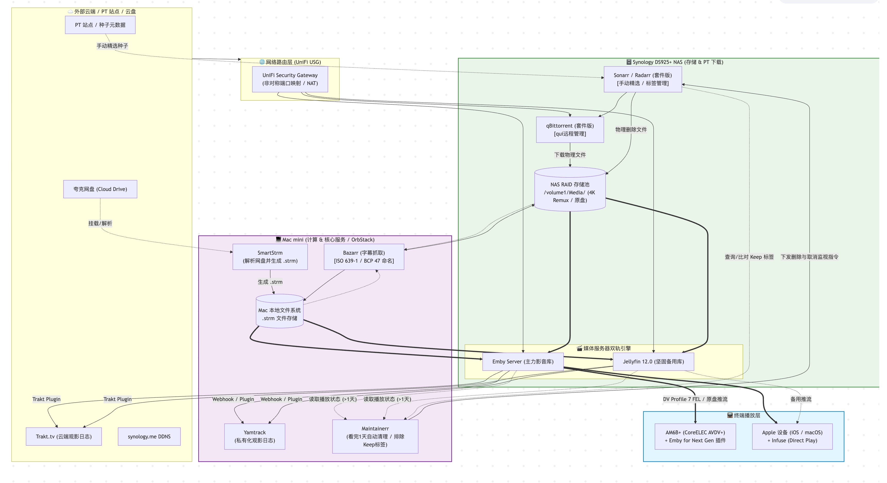

# 影音系统工作流能力报告

2026 年 10 月 23 日 · 对照用户提供的架构图 · 适用于未合并的 HTTP 修复分支

**Lilies 可以承担这张图里的业务判断、服务调用顺序、失败恢复和结果汇总。下载、存储、网盘挂载、字幕服务、媒体服务及终端播放继续由图中的外部系统承担。**当前已实际跑通的是清理流程的假后端版本；整套真实影音系统尚未接入。

合理的交付方式是：负责人提供服务连接、接口资料和业务规则，智能体编写适配并装配工作流，人将流程加入项目后运行。首次接入允许澄清、配置和迭代；不追求面对任意陌生系统一次自主完成交付。

## 原图展示的系统

原图是部署、数据流和控制关系的组合，并不是一条需要全部搬进 Lilies 的顺序工作流。图中有五条主要路径：PT 资源到 NAS；网盘到本地 .strm；字幕处理；媒体服务到播放终端；观看记录到清理动作。Lilies 适合组织其中的控制步骤，媒体数据仍沿专业服务之间的原路径传输。

“已验编排”表示在假后端上实际执行过；“条件接入”表示平台具备编排方式，但相应真实接口和动作仍需适配；“外部负责”表示工作由图中的专业服务或设备完成。一个环节可能同时包含可编排的控制动作和外部负责的实际功能。

## 逐项判断能做什么

| 图中环节 | Lilies 可以负责 | 当前不能据此承诺什么 | 当前判断 |
|---|---|---|---|
| PT 站点和手动精选种子 | 在有接口或导出资料时整理候选，按明确偏好筛选；配置提交接口后可传递选择结果 | 未验证真实站点登录、种子获取或提交；不代替 PT 站点和下载器，选择偏好也不能自行猜测 | 条件接入 |
| Sonarr / Radarr 和 Keep 标签 | 读取记录、按稳定编号关联影片、排除 Keep、对固定目标取消监控 | 本轮只验证模拟读取与取消监控；资源搜索、添加、质量配置、实际媒体文件管理尚未接通 | 已验部分编排 |
| qBittorrent 和 qui | 读取做种状态，按已定义的做种条件筛选；移除对应下载任务 | 实际下载、做种、协议连接由下载器承担；本轮未验证新增下载和 qui 界面控制 | 已验部分编排；下载由外部负责 |
| NAS 文件与 RAID 存储池 | 通过受限服务接口读取文件标识和版本、请求删除、回读核对 | 模拟删除只是后端状态变化，没有删除真实 NAS 文件；平台沙箱不能据路径直接访问 NAS，也不提供 RAID 存储 | 已验删除编排；存储由外部负责 |
| Maintainer 看完一天后清理 | 把观看条件、时间阈值、Keep 和做种规则组合成可编辑流程；固定目标并补齐未完成动作 | 本轮未上线替代真实 Maintainer，也没有运行常驻清理任务；“谁看完算看完”和时间来源要先明确 | 本轮核心已验编排 |
| Emby / Jellyfin 媒体库 | 在接口允许时读取媒体、用户观看状态；需要时编排媒体库刷新等控制动作 | 模拟观看数据主要来自 Emby；Jellyfin 只读取模拟目录。未验证双库同步、库扫描写入或主备切换 | 读取已模拟；其他控制需适配 |
| Trakt / Yamtrack 观影日志 | 汇总观看记录，按关联键形成处理报告；清理后写入处理日志 | 只有 Yamtrack 命名的模拟写日志接口验收通过；真实观看历史同步、账号授权、双向冲突处理尚未验证 | 日志编排部分已验 |
| 图中的 Webhook / Plugin 连线 | 已取得事件时可映射字段、关联对象，并把数据传给工作流 | 现有通用事件订阅使用 WebSocket，不能据此认定兼容图中所有 Webhook 或插件；本轮没有接收真实播放事件 | 条件接入 |
| 周期性检查和自动清理 | 可复用平台的通用每日调度能力设计检查流程 | 本例只验了项目手动和接口运行，尚未验证“项目连接＋定时启动”的完整路径；没有启动自动清理 | 条件接入 |
| 夸克网盘与 SmartStrm | 在接口可用时检查远端条目与本地指针的对应，整理失效项；代码节点可以形成 .strm 文本或修复方案 | 本轮仅读取模拟条目，未验证登录续期、挂载、下载链接解析、生成并写入 Mac 的 .strm 文件；这些需要相应服务或文件接口 | 条件接入；挂载解析由外部负责 |
| Bazarr 字幕抓取和命名 | 读取缺失字幕状态、按明确语言规则生成命名方案；接口支持时触发抓取并核对结果 | 本轮只读模拟缺失状态；未执行真实字幕搜索、下载、时间轴处理或字幕文件改名 | 条件接入；字幕服务由外部负责 |
| UniFi USG 和 synology.me DDNS | 从已有管理接口读取状态，整理连接检查结果 | 模拟接口返回“正常”不证明真实网络可达；未修改路由、NAT、端口映射或 DDNS，Lilies 不承担路由器功能 | 状态接入有条件；网络由外部负责 |
| Emby / Jellyfin 向 AM6+ / Apple / Infuse 推流 | 可组织接口层的状态查询和播放问题排查记录 | 不提供视频流转发、4K 解码、转码、Dolby Vision Profile 7 FEL 支持或播放器插件；这些也没有在本轮测试 | 外部负责 |
| Mac mini、OrbStack 与本地文件系统 | 把这些环境中已经部署的服务作为连接目标 | 不能因为图上有服务就视为已部署；本次没有安装软件、挂载目录或改变主机配置，代码沙箱也不是任意主机文件访问通道 | 外部环境准备 |

表中的“条件接入”需要实际服务提供相应操作与结果查询。当前项目连接提供基础地址、路径、HTTP 方法和由后端注入的认证头；如果服务需要会话登录、OAuth 自动刷新、动态签名等机制，还需明确适配方式。仅有 HTTP 地址不足以保证即插即用。

## 已跑通的清理工作流

1. 完整读取分页数据，检查页数、记录数量和字段结构。
2. 根据稳定编号、路径和下载任务标识关联对象；同名不靠标题猜，匹配不唯一则保留原因。
3. 应用 Keep、指定用户是否看完、完成时间、保留时长及做种条件，生成固定处理对象。
4. 对原目标依次请求删除文件、取消监控、移除下载任务、记录日志。
5. 重新查询原目标，分别核对四项动作，并生成本次结果。
6. 部分失败后继续原任务，或修改流程后使用恢复上下文补做余项。

这里的“看完一天”在演练中具体约定为：所有指定用户已看完，且距离最晚完成时间超过 24 小时。恰好 24 小时、缺少完成时间、缺少用户记录等对象不清理。这是可配置的演练业务规则，不是从架构图中自动推导出的唯一含义。

| 验证项目 | 实际结果 | 结论范围 |
|---|---|---|
| 正常业务路径 | 13 条影片记录中选出 4 个目标；完成 16 项状态变化 | 每个目标四项动作；不代表 13 条全部清理 |
| 删除后取消监控失败 | 已完成 5 项动作后停止；两种恢复方式最终均达到 16 项，删除请求总计 4 次 | 本轮已确认的删除不重复；不是任何外部系统都能无条件避免重复 |
| 故意省略日志 | 已执行的操作节点成功，结束检查仍判未完成；补齐后通过 | 只能发现已配置检查覆盖的遗漏，不能自动补全未知业务要求 |
| 服务和数据异常 | 503、401、字段变化、文件版本变化、写入后响应失败、权限和连接变更均有对应测试 | 可以拒绝、保留进度或在满足条件时重试；不要求每种异常都自动成功 |
| 更换数据约定 | 更换服务编号、分页大小和字段映射后仍完成对应四个目标 | 已测试这些变体；不等于兼容任意表结构和服务协议 |

**16 类服务只表示假后端提供了这些名称的模拟读取接口，不表示 16 个真实产品都已接入。**实际写入验收集中于 NAS 删除、Sonarr / Radarr 取消监控、qBittorrent 移除任务和 Yamtrack 日志。假后端不是原厂协议兼容实现。

截图中的四项检查均为 4/4。浏览器演练期间修复过页面问题，属于开发验收，不称为零技术介入盲测。当前未接入真实 NAS，也没有发生真实影片删除。

## 智能体通过平台如何完成

当前 Codex 根据需求编排工作流、编写适配代码，再通过平台保存、执行和修复。这符合智能体利用平台功能解决任务的方式。适配代码保存在普通代码节点内，执行时由平台沙箱运行；HTTP 操作由 HTTP 节点执行，Python 节点继续禁网。

为核对内部助手是否具备同样的接口，又使用普通项目账号做了专门验证：经 `workflow_draft` 助手工具保存同一套 11 个主流程节点（其中 4 个代码节点），人加入可调用能力后，经 `project_calls` 执行成功，得到 13 条分析记录、16 项动作及 4 次删除请求。运行不依赖测试仓库里的 Python 文件；这些文件只用于组织、保存和复现测试样例。

因此，平台内部助手拥有搭建与执行同类流程的接口，不需要开发者修改仓库的权限。具体后台模型生成适配代码的表现取决于其能力、资料和迭代过程；本轮没有另外启动平台模型会话测试这一部分。负责人配置连接和人加入项目能力，仍按已有产品分工完成。

这次修改的平台源码负责通用的服务连接、失败恢复和结果检查；影片筛选和清理规则属于工作流配置，没有写成平台里的专用影音执行器。

## 不需要强行承担的工作

- 不把整张部署图重建成 Lilies 内置服务，不新增下载器、播放器、网盘挂载器或 NAS 存储层。
- 不为每个服务名称新增专用积木。先用通用 HTTP、代码、循环和工作流组合；确有共性缺口时再补平台能力。
- 不凭缺失信息猜测影片身份、用户观看含义或删除目标；不以“文件已经不存在”替代剩余动作的核对。
- 不承诺所有外部写入都可自动重试或回滚。服务没有幂等保证、结果又查不清时，保留进度并停止自动重发。
- 不把任意陌生系统一次自主交付列为未来目标。首次接入可澄清和迭代，日常使用复用已经确认的配置与流程。

## 可交付范围与现阶段状态

当前可交付的是**清理流程的可编辑平台实现、合成服务验收、恢复机制与运行记录**。接入真实环境时，先选定实际版本和接口、确认标识及观看规则、配置连接，再逐项核对读取和写入；通过这些步骤后，才能称为该环境中的可用清理工作流。

图中其余链路可按真实需求逐条接入，不需要为了“覆盖全图”全部扩展。尤其要先决定由既有 Maintainer 还是 Lilies 发起同一清理任务，避免两个自动任务同时处理同一批目标。

实现提交为 `0cfdaa89`，长期能力边界提交为 `9cfaa7c0`，均在 `codex/http-workflow-recovery-20261023`。未合并、未发布，原 18401/18402 服务未更新。调试环境中的成功不能直接当作原服务已经具备这些修复。

## 证据与复现入口

- [HTTP 修复说明与行为测试命令](HTTP_WORKFLOW_RECOVERY.md)：连接权限、恢复路径及浏览器记录。
- [运行与测试摘要](media-workflow-capabilities-20261023/evidence/verification.json)：两轮恢复各自的真实任务编号、结果检查和假后端动作数量。
- [助手搭建接口核对](media-workflow-capabilities-20261023/evidence/assistant-authoring-proof.json)：普通账号保存代码节点和调用流程的结果。
- 源码：`tests/fixtures/media_workflow.py` 是可保存的流程定义；`media_decision.py` 和 `media_verify.py` 是节点内适配代码；`test_media_http_acceptance.py` 对照工作流输出与假后端状态。
- 本地后端回归 5605 通过、67 跳过；HTTP 专项 27/27 通过，包含另行启用的真实 Docker 用例；前端 563 通过。专项与全量有重叠，不相加。本报告整理期间没有重新执行全套测试，也没有新增付费模型调用；远端 CI 尚未运行。

本文对外部服务职责的描述依据用户提供的架构图；没有依据服务名称假定其实际部署版本、接口或授权方式。
