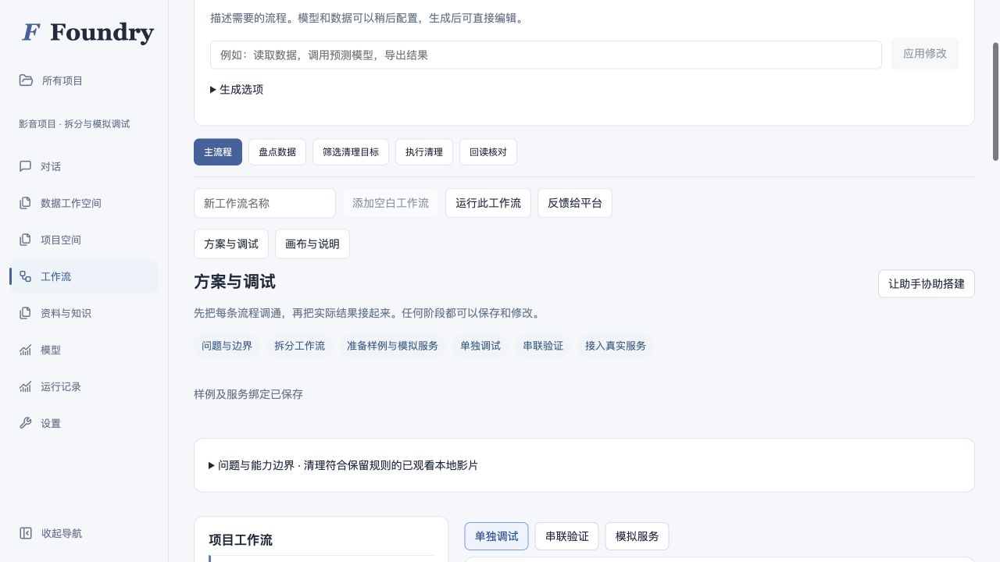
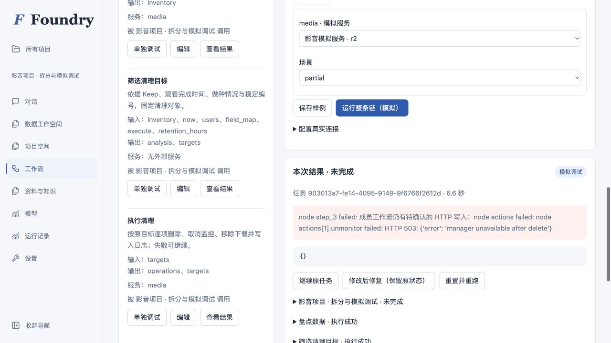
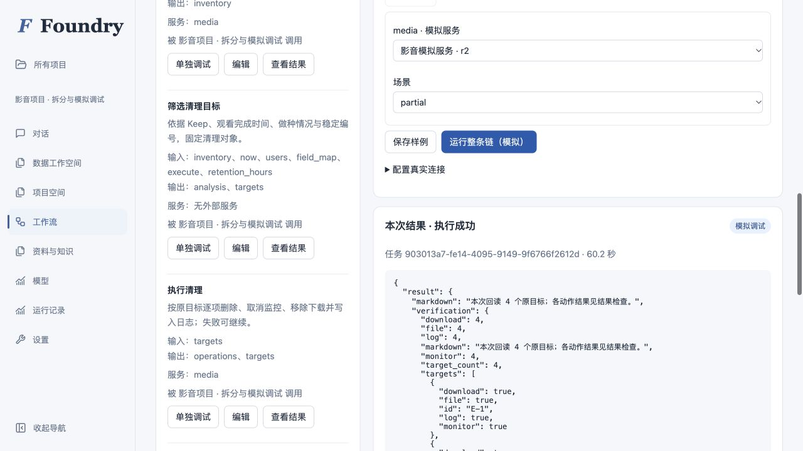

# 工作流拆分、独立调试与串联验证

2026-10-23 · 开发分支演练 · 合成影音服务

## 交付结论

平台内已形成「问题与边界 → 拆分工作流 → 准备样例和模拟服务 → 独立调试 → 实际输出串联 → 配置真实连接」路径。该页面使用现有工作流、项目任务、测试用例、HTTP 执行器及禁网沙箱；没有另建执行图或审批阶段。

影音示范拆成四条普通成员流程：**盘点数据 → 筛选清理目标 → 执行清理 → 回读核对**。筛选、执行、核对均能用合成输入独立运行；主流程再把实际上游输出传给下游。

本次只验证平台在约定模拟接口下的编排与调试能力。真实 Emby、Radarr、qBittorrent、NAS 等未接入；模拟接口不是原厂 API 复刻。未调用付费模型，未把适配器桩测试称为真实模型自主生成质量证明。

## 实际操作

- 普通账号创建的项目，通过页面编辑边界、选择成员流程和样例、显式绑定模拟服务、保存映射并运行整链。
- 页面可保存记录服务预设；自写 Python 通过相同的 `project_services` 保存，在平台禁网沙箱执行，不需要修改平台源码。
- 可将本次 `targets` 输出固定为下游样例；页面自动选中刚保存的样例，服务绑定仍需明确选择。
- 运行结果显示模拟/真实服务环境、任务状态、流程版本、模拟服务版本、实际输入输出、HTTP 请求及服务状态。
- 部分完成后有「继续原任务」「修改后修复」「重置并重跑」三个入口，分别保留原快照、保留状态创建修复任务、创建全新状态。

## 可核对的验收

| 范围 | 观察结果 | 证据来源 |
|---|---|---|
| 四条独立流程 | 下游使用合成输入直接运行；筛选检查 13 条、固定 4 个目标 | Docker 行为测试 + 普通账号页面 |
| 整链映射 | 5 次工作流运行（主流程 + 4 成员）；4 个原目标，各有文件、监控、下载、日志 4 类核对 | 页面任务 + 模拟状态 |
| 数据边界 | 保留 Keep、未全员观看、仍做种、刚看完、网盘、缺记录、重复外部编号、缺完成时间和恰好一天的对象；同名但不同稳定编号可独立处理 | 13 条合成夹具 |
| 部分完成 | 删除后取消监控 503 导致未完成；继续后补齐，删除请求不重复 | 页面 + Docker 行为测试 |
| 修改后修复 | 故意省略日志时整链失败；补回日志后修复，原目标未被重新筛掉，删除仍各一次 | Docker 行为测试 |
| 响应丢失 | 状态先写入，再丢失响应；相同操作标识重试，作用不重复 | 页面 + Docker 行为测试 |
| 错误输入/服务 | 401、字段变化、文件版本变化不能报成功；读取 503 可有限重试 | Docker 行为测试 |
| 并发与恢复 | 独立测试互不污染；重复请求只创建一个任务；同状态的修复与继续不能并发；重启后可恢复 | 普通账号 API 行为测试 + Docker |
| 变化后仍可用 | 更换服务编号、分页大小、字段名后运行与恢复成功；服务更新后历史结果保留旧版本 | Docker + 版本行为测试 |
| 隔离 | 空绑定、跨项目服务、未隔离副作用节点明确拒绝；旧 connection_id 只能经显式模拟映射；真实假后端未收到请求，真实凭据不进入结果 | 普通账号 API 行为测试 |
| 两种助手 | API 助手及 Codex 适配器调用相同 project_services/project_debug；未加入正式能力的草稿可模拟，正式调用仍被拒绝 | 两条适配器的工具调用测试，未调用真实模型 |

测试包：`tests/test_project_debug.py`、`tests/test_project_debug_media.py`、`tests/test_project_http_connections.py`、`tests/test_project_assistant_scope.py`、`platform/frontend/tests/project-workflow-debug.test.tsx`。

## 页面演练口径

操作者为 Codex 的浏览器自动化，使用普通项目用户，不是独立业务人员可用性研究。演示账号、模拟服务、四条草稿和样例预先由可复现种子脚本通过普通项目/助手接口准备；不计入业务重复使用的零救援指标，不能据此声称零配置接入新系统。

页面演练及收尾检查发现并修复三处交互问题：工作流深链接未加载流程数据；将输出保存给下游后默认选择旧样例；初始化重复读取样例可能覆盖刚选的场景。代码核对另补齐串联节点编号重映射、删除来源后的明确缺项、切换结果时清空旧输出选择、加载样例期间禁止误跑，以及共享模拟状态的并发保护。

固定流程复跑记录为 **439.2 秒（约 7 分 19 秒）、7 次计划内配置、0 次技术救援**，范围不包括首次准备和上述开发补修。详细操作时间点见 [浏览器记录](browser-trial.json)，任务编号和服务实际状态见 [运行记录](run-summary.json)。耗时包含浏览器操作、任务等待、截图及记录，不作为真人操作速度或性能基准。计划内选择样例、绑定服务、保存映射和点击恢复不算技术救援；只有修改源代码、数据库或通过页面之外替任务补结果才计入救援。

## 截图

[查看完整页面](workspace-full.jpg)

## 验证与复现

本地后端全量 **5641 通过、76 跳过**；后续补修受影响 38 项及调试专项 11 项通过（集合重叠），Docker 影音专项 **9 通过**。前端最终全量 **572 通过**，类型检查和生产构建通过，Ruff F 检查通过。最新远端状态见 [本开发分支的 CI](https://github.com/FlashBlank7/Lilies/actions?query=branch%3Acodex%2Fworkflow-debug-workspace-20261023)。运行命令和协议见 [使用说明](../../WORKFLOW_DEBUG.md)。页面入口为独立本地演示环境的 `/projects/{project_id}?tab=flow`。

注意：模拟网关是 HTTP 客户端内部 transport，保留平台 HTTP 重试与恢复路径；不经过真实网络，所以 DNS、TLS、厂商服务负载和真实权限需另行验证。Python 实现约定支持幂等时，必须实际实现去重。当前串联表单用于顺序调用链；带条件分支、循环或其他控制节点的主流程应继续使用画布编辑，不应把顺序链保存当作复杂控制图的无损转换。

本轮不合并、不发布，原服务 checkout 与端口未替换。
